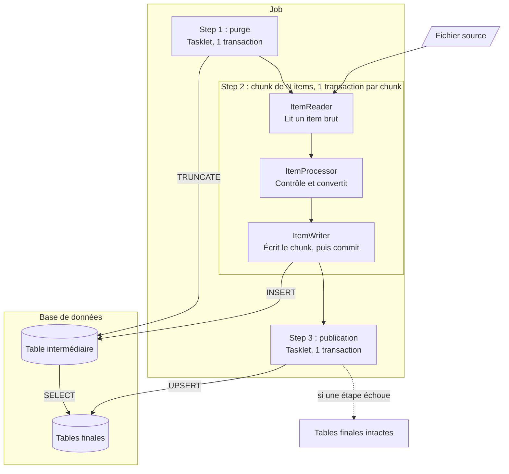

# personne-batch

Importe un fichier CSV de personnes et de leurs adresses dans une base PostgreSQL.
L'import est tout ou rien : les tables `personne` et `adresse` ne changent que si tout le fichier a réussi.
Java 17, Spring Boot 4.1, Spring Batch 6, Spring Data JPA, Lombok.

## Préparation de la base

À faire une fois, avec un superutilisateur PostgreSQL :

```bash
psql -U postgres -f db/creation-base.sql
```

Le script crée l'utilisateur `personne` et deux bases : `personnes` pour le batch, `personnes_test` pour
les tests d'intégration. Les tables sont créées au premier lancement (`schema.sql`), puis `data.sql` y
ajoute quelques personnes et adresses, dont certaines figurent aussi dans le fichier CSV.

## Lancement

```bash
./mvnw clean package
java -jar target/personne-batch-0.0.1-SNAPSHOT.jar --fichier=input/personnes.csv
```

Code retour : 0 si le job réussit, 1 sinon.

| Paramètre | Défaut | Rôle |
| --- | --- | --- |
| `--fichier` | `personne.batch.fichier` | Fichier CSV à importer |
| `--idImport` | date et heure du lancement | Identifie l'import dans l'historique Spring Batch |

| Variable d'environnement | Défaut | Rôle |
| --- | --- | --- |
| `PERSONNE_DB_URL` | `jdbc:postgresql://localhost:5432/personnes?reWriteBatchedInserts=true` | Base du batch |
| `PERSONNE_DB_USERNAME` / `PERSONNE_DB_PASSWORD` | `personne` / `personne` | Compte de la base |
| `PERSONNE_DB_TEST_URL` | `jdbc:postgresql://localhost:5432/personnes_test?reWriteBatchedInserts=true` | Base des tests, **vidée à chaque test** |

| Propriété (`application.yml`) | Défaut | Rôle |
| --- | --- | --- |
| `personne.batch.fichier` | `./input/personnes.csv` | Fichier importé sans `--fichier` |
| `personne.batch.chunk-size` | 500 | Lignes par transaction |
| `personne.batch.skip-limit` | 100 | Lignes rejetées signalées avant d'arrêter la lecture |

## Format d'entrée

UTF-8, séparateur `;`, une ligne d'en-tête.

```text
nom;prenom;age;profession;numero;rue;codePostal;ville
Dupont;Marie;35;Infirmière;12;rue de la Paix;75002;Paris
```

Deux fichiers de 20 000 lignes sont fournis, produits par `GenerateurFichierPersonnes` (dans `src/test`) :

- `input/personnes.csv` : toutes les lignes sont valides, pour 17 084 personnes différentes (les autres lignes sont des doublons de nom et prénom) ;
- `input/personnes-invalides.csv` : 14 lignes ont un âge invalide, pour montrer l'abandon de l'import.

## Fonctionnement

Le principe, indépendamment des données traitées :



Dans le step 2, seul l'`ItemWriter` écrit en base. Les flèches `SELECT` et `UPSERT` sont une même requête
`INSERT ... SELECT ... ON CONFLICT DO UPDATE`, exécutée dans la base. L'échec est rattaché au step 3 pour
la lisibilité, mais il vaut pour les trois steps (voir « Échecs : tout ou rien »).

Dans ce projet, le job enchaîne trois steps :

1. **`purgeImportStep`** : vide la table intermédiaire `personne_import`.
2. **`importFichierStep`**, par chunks de 500 lignes, chacun dans sa transaction :
   - `FlatFileItemReader` et `LignePersonneLineMapper` découpent chaque ligne en `LignePersonne`, où tout
     est encore du texte ;
   - `PersonneItemProcessor` vérifie que l'âge est un nombre entier positif et construit l'entité JPA
     `PersonneImport` ;
   - `JpaItemWriter` l'enregistre dans `personne_import`.
3. **`publicationStep`** : `PublicationTasklet` recopie `personne_import` vers `adresse` puis `personne`,
   en une seule transaction, et vide la table intermédiaire.

Les chunks n'écrivent donc jamais dans les tables finales. Elles sont représentées par les entités JPA
`Personne` et `Adresse`, et alimentées par deux requêtes SQL de `PersonneImportRepository`.

Règles d'identité, appliquées en base par des contraintes d'unicité :

- une **personne** est identifiée par son nom et son prénom. Si elle existe déjà, elle n'est pas recréée :
  son âge, sa profession et son adresse sont mis à jour avec les valeurs du fichier. Si elle figure
  plusieurs fois dans le fichier, sa dernière ligne l'emporte ;
- une **adresse** est identifiée par numéro, rue, code postal et ville. Si elle existe déjà, elle est
  réutilisée : les personnes qui ont la même partagent une seule ligne de la table `adresse`.

Conséquences à connaître :

- deux homonymes (même nom, même prénom) sont une seule personne pour le batch ;
- quand une personne change d'adresse, l'ancienne adresse reste en base, même si plus personne n'y habite ;
- les comparaisons sont exactes (casse et accents compris) ;
- une personne en base mais absente du fichier est conservée telle quelle.

## Échecs : tout ou rien

| Erreur | Ce qui se passe | Tables `personne` et `adresse` |
| --- | --- | --- |
| Âge qui n'est pas un nombre, ou ligne sans ses huit colonnes | La ligne est journalisée avec son numéro, la lecture continue pour signaler les autres, puis la publication est refusée | Inchangées |
| Erreur d'écriture dans un chunk (valeur trop longue, base indisponible) | `importFichierStep` échoue ; les chunks précédents ne sont validés que dans `personne_import` | Inchangées |
| Erreur pendant la publication | La transaction unique est annulée | Inchangées |
| Fichier introuvable | `importFichierStep` échoue | Inchangées |

Dans tous ces cas, le job se termine en échec (code retour 1). Corrige le fichier puis relance : chaque
lancement repart d'une table intermédiaire vide et relit le fichier depuis le début.

Au-delà de `skip-limit` lignes rejetées, la lecture s'arrête sans attendre la fin du fichier.

Après un échec, `personne_import` garde les lignes de l'import raté jusqu'au lancement suivant. Le batch
n'est pas prévu pour deux imports simultanés : ils partageraient cette table.

Les `id` peuvent avoir des trous : la requête de publication consomme une valeur de séquence même pour une
personne qui est seulement mise à jour.

## Mesurer le temps d'exécution

**Dans les logs.** `MesureTempsListener` écrit la durée du job et de chaque step, avec le débit de lecture :

```text
Step importFichierStep : 20000 lignes lues, 20000 écrites, 0 rejetées, 40 commits en 0,518 s (38610 lignes/s)
Publication : 5799 adresses créées, 17084 personnes créées ou mises à jour
Step publicationStep : COMPLETED en 0,210 s
Job importPersonnesJob : COMPLETED en 0,809 s
```

Pour la durée de chaque chunk, passe ce listener en DEBUG :

```bash
java -jar target/personne-batch-0.0.1-SNAPSHOT.jar --logging.level.fr.personne.batch.job.MesureTempsListener=DEBUG
```

**En base.** Spring Batch enregistre le début et la fin de chaque exécution, ce qui garde l'historique :

```sql
select step_name, status, end_time - start_time as duree, read_count, write_count, commit_count
from batch_step_execution
order by start_time desc;
```

**Dans les tests.** `JobExecution.getStartTime()` et `getEndTime()` donnent la durée ; le test
`importeVingtMilleLignes` l'affiche.

**Pour aller plus loin.** Spring Batch publie aussi des métriques Micrometer (durée des jobs, steps,
lectures et écritures), exploitables avec Actuator et un outil comme Prometheus. Ce n'est pas branché ici.

Les réglages qui pèsent le plus sur la durée : `personne.batch.chunk-size`, `hibernate.jdbc.batch_size` et
`reWriteBatchedInserts` dans l'URL JDBC.

## Tests

```bash
./mvnw test
```

- **Unitaires** (JUnit Jupiter, Mockito), sans base : `PersonneItemProcessorTest`,
  `LignePersonneLineMapperTest`, `PublicationTaskletTest`.
- **Intégration** (`@SpringBatchTest`), sur la base `personnes_test` : `ImportPersonnesJobIntegrationTest`
  lance le vrai job sur de petits fichiers et sur 20 000 lignes générées, et vérifie que chaque type
  d'échec laisse les tables finales intactes.
